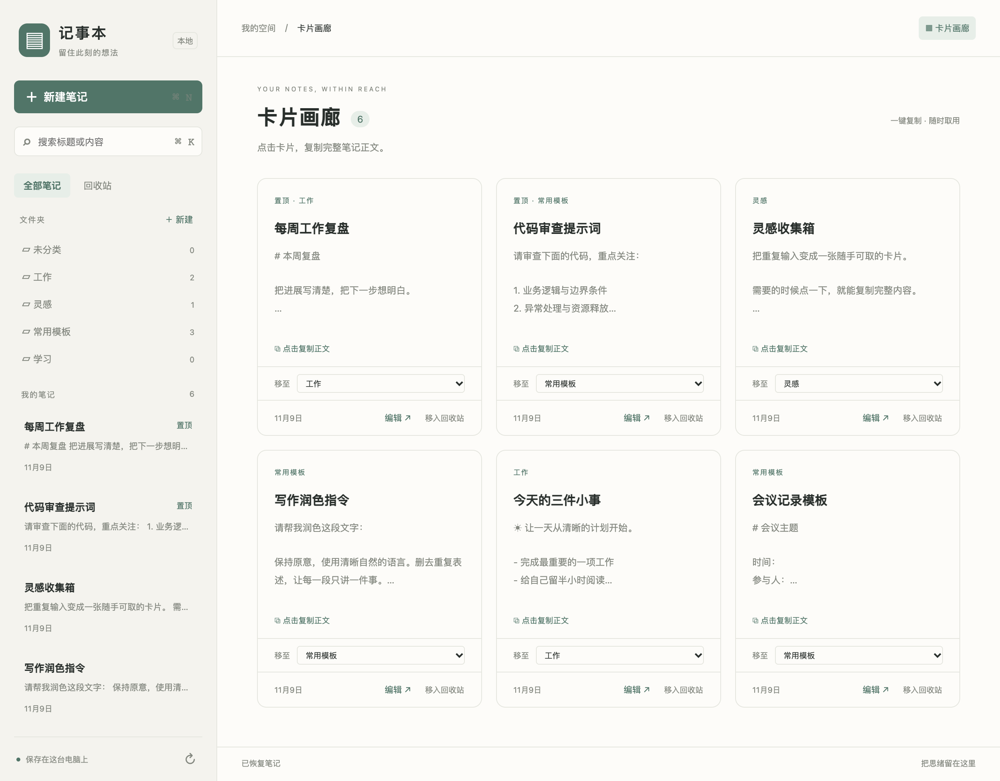
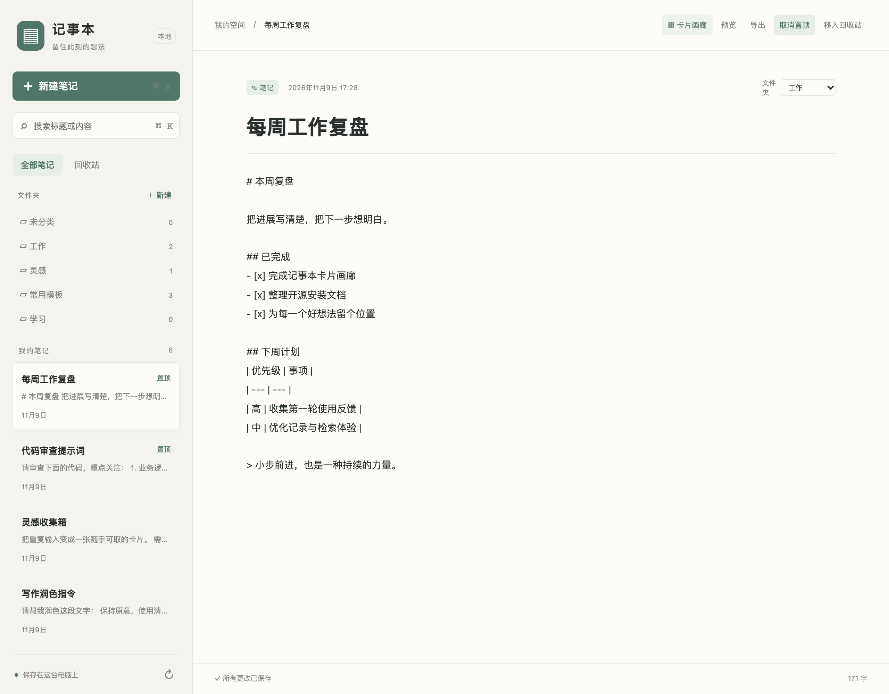
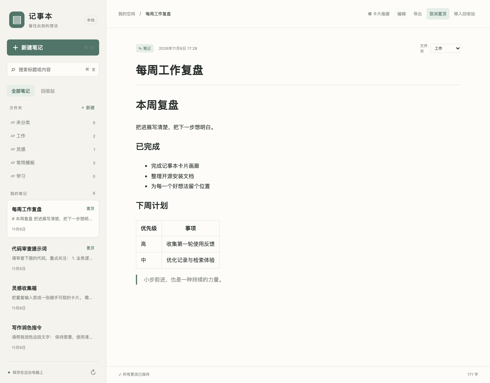
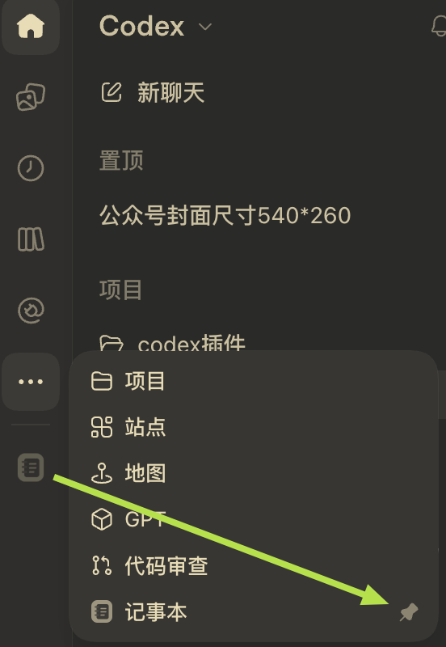

# Codex Notepad · 本地记事本

一个开源的 Codex 桌面端记事本插件：以卡片浏览笔记，点击卡片复制完整正文，点击「编辑」继续记录。数据保存在自己的电脑上，无需自建服务器。



| Markdown 编辑器 | Markdown 预览 |
| --- | --- |
|  |  |

*上方三张功能截图使用专门创建的演示笔记。*

**固定到侧边栏：**安装后，打开左侧「···」更多菜单，找到「记事本」，点击其右侧的图钉，即可将入口固定到侧边栏。



**安装 agent：请完整阅读本文，并按下方「Agent 安装协议」操作。不要复制他人电脑上的 MCP 配置。**

仓库：[Drok1015/codex-notepad](https://github.com/Drok1015/codex-notepad) · 许可证：[MIT](LICENSE) · 当前版本：`0.4.0`

## 功能

- 卡片画廊，点击卡片复制完整笔记正文，保留 Markdown、Unicode 和换行，不含独立标题字段。
- 左侧支持新建文件夹、按文件夹筛选以及「未分类」。卡片和编辑器中的文件夹下拉框可移动笔记；在文件夹下新建笔记会自动归入该文件夹。
- 卡片底部可直接「移入回收站」，不会触发复制；从回收站恢复时保留原文件夹。
- 标题与正文搜索、置顶、新建、编辑、650 毫秒自动保存。
- Markdown 安全预览、单篇 Markdown 导出。
- 回收站及恢复，无永久删除功能。
- 多窗口版本冲突保护，冲突时保留编辑器草稿并支持另存副本。
- 注册侧边栏与聊天侧面板入口；支持在聊天中读取、整理和创建笔记。

## 支持环境

| 项目 | 要求 |
| --- | --- |
| 系统 | macOS；Windows / Linux 暂不支持正式安装，复制依赖 macOS `pbcopy` |
| Node.js | 22.13.0 或更高，推荐 Node 22 的最新维护版；需要 npm |
| Codex CLI | 支持 `codex plugin marketplace add` 和 `codex plugin add --json` |
| 桌面客户端 | 支持本地 MCP 插件与 MCP Extensions 入口的 Codex / ChatGPT 桌面端 |
| 网络 | 首次下载源码、npm 依赖时需要网络；运行时笔记服务不连接外部服务 |

如果 CLI 过旧，请按 [Codex 官方安装说明](https://developers.openai.com/codex/cli) 更新。不同客户端、版本和账号的入口可用性可能不同：CLI 安装成功不等于侧边栏已经显示。

## 快速安装

安装目录可以自行选择，包含空格或中文也可以。需要 Git；也可以从 GitHub 下载 ZIP、解压并进入仓库目录后执行最后一行。

```bash
git clone https://github.com/Drok1015/codex-notepad.git
cd codex-notepad
bash scripts/install.sh
```

脚本会检查环境，安装锁定依赖，构建并测试程序，注册本地插件源，安装插件，再执行独立握手验证。无需 `sudo`。

安装完成后，完全退出并重新打开 Codex，查找侧边栏「记事本」。如果入口在「···」更多菜单中，点击「记事本」右侧的图钉即可固定到侧边栏，操作见上方标注图。打开后应看到卡片画廊；已有笔记会自动显示。也可以在新聊天中说「打开记事本」。

可以把下面这段交给你的 agent：

> 请安装 https://github.com/Drok1015/codex-notepad 。先完整阅读仓库 README.md，按其中「Agent 安装协议」检查环境、安装和验证，并报告实际结果。

## Agent 安装协议

本节适用于**用户已要求安装或更新**的情况。仅阅读源码或回答问题时，不执行安装。

1. **读取文档和选择目录。** 完整读取本 README 与根目录 `AGENTS.md`。新安装时克隆到用户选择的目录；已有检出先查看 `git status --short`，有未提交修改时保留修改，不执行重置、清理或强制覆盖。
2. **检查环境。** 在仓库根目录执行下面的命令。缺少依赖时，按用户已授权的范围补齐；不能完成时报告具体缺失项。不要改写用户的 HOME 或 Codex 数据目录。

```bash
node --version
npm --version
codex --version
node scripts/runtime.mjs --check
```

3. **安装。** 从仓库根目录执行 `bash scripts/install.sh`。该步骤顺序为：

```bash
npm ci --ignore-scripts
npm run build
npm test
npm run install:plugin
npm run verify:plugin
```

4. **核对结果。** 以上命令应全部退出码为 0。安装器将本机状态写入 `.local/install.json`，其 `pluginId` 应为 `local-notepad@codex-notepad`，`version` 应与 `package.json` 一致。`verify:plugin` 必须显示「验证通过」，它会从实际缓存目录的 `.mcp.json` 原样启动服务，核对版本、10 个工具、图标、两个入口及文件夹画廊 UI。
5. **核对界面。** 请用户完全退出并重新打开桌面应用。只有实际观察到「记事本」入口与卡片画廊，才能报告界面验证通过。如果工具不能访问应用界面，明确写「服务验证通过；界面待用户确认」，不要将预览网页或工具列表当成侧边栏显示的证据。不要自动结束用户正在进行的聊天或强制退出应用。
6. **报告。** 提供安装版本、插件 ID、测试和握手结果、是否验证实际界面，以及下一步。任何阶段失败都先定位该阶段，不能跳过失败继续声称安装完成。

### 安装器会改变什么

- 以本仓库的 `.agents/plugins/marketplace.json` 注册名为 `codex-notepad` 的本地插件源。
- 安装 `local-notepad@codex-notepad`，由 Codex CLI 更新自己的插件配置和缓存。
- 自动使用当前 Node 的真实可执行路径和 CLI 返回的实际缓存路径，生成 `release/.mcp.json`。安装后的启动路径位于缓存包内，不依赖源码目录的名称。
- 在仓库内生成 `node_modules/`、`dist/`、`release/`、`.local/`；这些文件全部不进 Git。
- 不读取个人笔记、不修改真实剪贴板来验证、不覆盖其他插件源。安装验证使用一次性临时数据库。

不要直接将本机 `release/` 发给别人，也不要将 `.mcp.json` 提交到 Git。别人应从源码运行安装器，在自己的机器上生成路径。目前旧格式 `.mcp.json` 的 `${PLUGIN_ROOT}` 在已测试的桌面运行时没有展开，因此安装器使用实际路径。

## 更新、迁移与卸载

更新前确保本仓库没有未提交的改动，然后在仓库根目录执行：

```bash
git pull --ff-only
bash scripts/install.sh
```

重启桌面应用后生效。更新不会删除笔记。更换机器、移除所用 Node 版本，或移动用于插件源的源码目录后，应重新执行安装器。若提示同名 marketplace 已来自旧目录，先检查 `codex plugin marketplace list`；只有确认旧目录属于本插件后，才移除该源并在新目录重新安装。

0.4.0 会自动为旧数据库添加文件夹表和笔记的 `folder_id` 列。原笔记默认归入「未分类」，保留正文、ID、置顶、时间、版本及回收站状态。文件夹为单层分类，当前提供新建与移动，不提供重命名、删除或嵌套。

卸载本插件：

```bash
codex plugin remove local-notepad@codex-notepad
codex plugin marketplace remove codex-notepad
```

卸载不会删除笔记数据库。早期测试版可能使用 `local-notepad@local-notes`，这是另一个插件 ID；不要误删其他插件。新旧版本默认使用相同的本地数据目录。

## 数据、隐私与保存

默认目录：`~/.local/share/codex-notepad/`，数据库：`notes.sqlite`。可以在 MCP 运行环境设置 `NOTEPAD_DATA_DIR` 使用其他目录；安装器不会搬迁数据。

- 笔记留在本机，没有云同步。数据库文件权限为 `0600`，新建数据目录权限为 `0700`。
- 在聊天中读取笔记时，工具返回的内容会进入该聊天上下文；“本地存储”不表示聊天内容不会交给模型处理。
- 点击卡片会把正文写入 macOS 剪贴板；成功后显示「已复制」，失败时提示并允许重试。
- 备份时先关闭笔记窗口和本地预览服务，再复制整个数据目录，包括可能存在的 SQLite `-wal`、`-shm` 文件。
- 保存失败或冲突时，未保存内容仍在当前编辑器内。保持窗口打开，重试或另存副本；宿主强制关闭可能丢失未保存草稿。

## 排错

| 现象 | 检查与处理 |
| --- | --- |
| 环境检查失败 | 确认 macOS、Node 22.13+、npm 和支持插件命令的 Codex CLI |
| 安装成功但没有图标 | 先运行 `npm run verify:plugin`；服务通过后重启桌面应用，再核对客户端是否支持本地 MCP 入口 |
| `MODULE_NOT_FOUND` / 握手时服务退出 | 重新运行安装器生成本机路径；不要手动替换为 `${PLUGIN_ROOT}` 或他人的路径 |
| 同名插件源已注册到旧目录 | 查看 `codex plugin marketplace list`，确认对应本插件后移除旧源并重新安装 |
| 更新后仍是旧界面 | 完全退出并重开应用；核对 `.local/install.json` 与验证输出版本 |
| 保存冲突 | 先「另存为新笔记」保留草稿，再重新加载；不要盲目重试覆盖 |
| 复制失败 | 确认在 macOS 本机运行，重试卡片；不要为测试复制用户的私人内容 |

## 开发与维护

```bash
npm ci --ignore-scripts
npm run build
npm test
npm start
```

`npm start` 仅启动本机独立预览 `http://127.0.0.1:43827/`，不会安装插件。默认共享本机笔记；开发时请用临时目录，例如：

```bash
NOTEPAD_DATA_DIR=/tmp/codex-notepad-demo npm start
```

服务仅监听 loopback，校验 Host / Origin，拒绝跨站写入；通过 `NOTEPAD_PORT` 更换端口。

| 路径 | 职责 |
| --- | --- |
| `server/store.mjs` | SQLite 持久化、版本检查和回收站 |
| `server/index.mjs`、`server/tools.mjs` | MCP 服务、UI 资源和 10 个工具 |
| `server/clipboard.mjs` | macOS UTF-8 剪贴板写入 |
| `web/` | 画廊、编辑器和经过 DOMPurify 处理的 Markdown 预览 |
| `scripts/install.sh`、`scripts/install.mjs` | 依赖、构建、测试、路径探测和安装 |
| `scripts/verify.mjs` | 实际缓存包的握手与入口验证 |
| `tests/` | 存储、冲突、UI、复制和含中文空格目录的安装测试 |

文件夹工具：`list_folders` 返回文件夹和有效笔记数量，`create_folder` 新建文件夹。`list_notes` 的 `folderId` 省略时查询所有分类、传 `null` 查询未分类、传 UUID 查询指定文件夹；搜索词与分类同时生效。`create_note` 可传 `folderId`，`update_note` 使用最新 `version` 更新 `folderId`（`null` 移回未分类）。移动与删除均执行版本冲突检查。

维护要求：修改安装、工具契约、功能或最低版本时，同步更新本 README、`AGENTS.md` 和测试。版本发布时同步 `package.json`、锁文件、插件 manifest、MCP serverInfo、前端 App 版本与本 README；UI 发生不兼容变更时升级资源 URI。CI 在 macOS 和 Linux 上构建测试；Linux 跳过 macOS 安装集成测试。

本仓库通过 GitHub 源码分发，尚未上架官方目录，也不应直接把源码仓库作为“无需构建的一键 marketplace”添加。请先按本文运行安装器。原始代码采用 MIT，依赖声明见 [第三方说明](THIRD_PARTY_NOTICES.md)；构建目录内附依赖许可原文。

官方参考：[插件打包与分发](https://developers.openai.com/plugins/build/plugins)、[插件扩展](https://developers.openai.com/plugins/build/extensions)。
